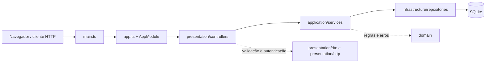
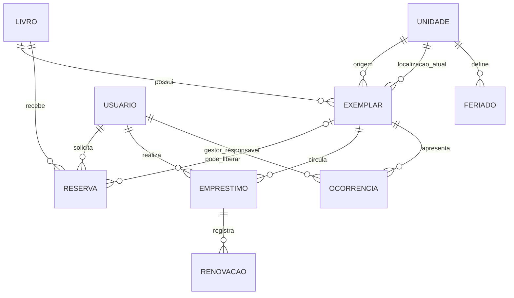

# Arquitetura e domínio

## Visão geral

A aplicação é um monólito modular pequeno, organizado por responsabilidades. A separação atual privilegia camadas: HTTP, casos de uso, domínio e acesso a dados. O banco SQLite é local; a interface web é servida como arquivo estático pela própria API.



Fluxo típico de uma requisição:

1. `main.ts` abre o banco, garante os dados iniciais e inicia o servidor.
2. `app.ts` configura o NestJS, o tratamento de erros, a validação, o Swagger e os arquivos estáticos.
3. Um controller converte a requisição HTTP em uma chamada ao serviço de aplicação.
4. O serviço aplica as regras do negócio e coordena as operações necessárias.
5. Os repositórios leem ou gravam no SQLite. Operações que precisam ser atômicas usam `transacao`.
6. A resposta retorna pelo controller; exceções conhecidas são convertidas para o formato HTTP padronizado.

## Mapa de arquivos

| Caminho | Responsabilidade |
| --- | --- |
| `src/main.ts` | Ponto de entrada: abre o banco, carrega dados iniciais, inicia o NestJS e encerra recursos |
| `src/app.ts` | Configura pipes, filtros, Swagger, limites do corpo HTTP, CORS e conteúdo estático |
| `src/app.module.ts` | Registra controllers, serviços e o guard de acesso no contêiner NestJS |
| `src/application/contexto.ts` | Fornece o banco, a data atual e a configuração de autenticação aos serviços |
| `src/application/services/` | Implementa catálogo, acervo, reservas, empréstimos e cálculo de dias úteis |
| `src/domain/entities/` | Descreve os principais conceitos do negócio |
| `src/domain/erros.js` | Define erros de aplicação com status e códigos HTTP |
| `src/infrastructure/repositories/` | Encapsula consultas e comandos SQL por recurso |
| `src/infrastructure/database/schema.sql` | Define tabelas, chaves estrangeiras, índices e restrições |
| `src/infrastructure/database/index.js` | Abre/configura o SQLite e oferece transações |
| `src/infrastructure/database/demo.js` | Cria os dados iniciais ou prepara o banco de demonstração |
| `src/infrastructure/token.js` | Calcula o hash usado para localizar credenciais persistidas |
| `src/presentation/controllers/` | Define os endpoints e delega o trabalho aos serviços |
| `src/presentation/dto/` | Valida e documenta os dados aceitos pela API |
| `src/presentation/http/` | Controla acesso, valida parâmetros e formata exceções HTTP |
| `src/presentation/mappers/` | Monta representações de catálogo e circulação para as respostas |
| `public/` | Implementa o catálogo web estático |
| `test/biblioteca.test.js` | Exercita endpoints e regras usando um banco em memória |
| `scripts/iniciar.js` | Inicia a versão compilada a partir de `dist/` |

### Convenções de dependência

- Controllers cuidam do protocolo HTTP; não devem conter consultas SQL nem implementar regras do negócio.
- Serviços de aplicação coordenam casos de uso e transações.
- Repositórios encapsulam SQL; não devem depender de controllers.
- DTOs são a fronteira de entrada HTTP e devem rejeitar campos desconhecidos ou inválidos.
- Mudanças no esquema devem preservar referências e invariantes do domínio e vir acompanhadas de testes.

O código atual ainda contém alguns módulos JavaScript/CommonJS junto ao TypeScript e serviços que importam DTOs ou mappers da camada de apresentação. Essa configuração é mantida para evitar uma migração ampla neste trabalho; ao alterar esses pontos, evite ampliar o acoplamento. Uma evolução futura pode mover contratos de entrada/saída para tipos da aplicação e padronizar gradualmente os módulos em TypeScript.

## Modelo do domínio



- **Livro** é o título bibliográfico; **Exemplar** é uma cópia física e tem unidade de origem, unidade atual e situação.
- **Unidade** organiza o acervo e os feriados usados no cálculo de prazos.
- **Usuário** tem perfil `leitor`, `bibliotecario` ou `gestor`.
- **Reserva** liga um leitor a um título; quando liberada, associa um exemplar e prazo para retirada.
- **Empréstimo** liga leitor e exemplar, registra retirada e devolução; cada renovação fica no histórico.
- **Ocorrência** registra avaria ou extravio e o gestor responsável.

## Regras de negócio implementadas

1. Um leitor não pode manter duas reservas ativas para o mesmo título. A fila atende a ordem de entrada.
2. Só se empresta exemplar disponível. Havendo reserva liberada, o empréstimo respeita o leitor prioritário.
3. O prazo inicial é de sete dias úteis, considerando fins de semana e feriados da unidade.
4. A retirada de uma reserva liberada tem prazo de dois dias úteis; após o vencimento, um bibliotecário pode registrá-la como expirada.
5. Renovação exige empréstimo ativo e dentro do prazo, e não é permitida enquanto houver fila ativa para o título.
6. Devolver fora da unidade de origem coloca o exemplar em transferência; a unidade de origem precisa recebê-lo antes de voltar à disponibilidade.
7. Uma ocorrência torna o exemplar indisponível e pode levar a reserva pendente a ser associada a outra cópia disponível.
8. Livros ou exemplares com vínculos ou histórico não podem ser removidos de forma a quebrar a integridade dos registros.

As regras são aplicadas pelos serviços e reforçadas, quando apropriado, por restrições e índices em `schema.sql`.

## Rotas e perfis

Rotas sem perfil indicado são públicas. Para rotas protegidas, `AcessoGuard` autentica e confere o perfil necessário.

| Recurso | Rotas | Acesso |
| --- | --- | --- |
| Livros | `GET /livros`, `GET /livros/{id}` | Público |
| Livros | `POST /livros`, `PUT /livros/{id}`, `DELETE /livros/{id}` | Bibliotecário ou gestor |
| Exemplares | `GET /exemplares`, `GET /exemplares/{id}` | Público |
| Exemplares | `POST /exemplares`, `PUT /exemplares/{id}`, `DELETE /exemplares/{id}` | Bibliotecário ou gestor |
| Transferência | `PATCH /exemplares/{id}/recebimento` | Bibliotecário |
| Reservas | `POST /reservas`, `PATCH /reservas/{id}/cancelamento` | Leitor |
| Reservas | `GET /reservas`, `GET /reservas/{id}` | Leitor (somente próprias) ou bibliotecário |
| Reservas | `PATCH /reservas/{id}/expirar` | Bibliotecário |
| Empréstimos | `GET /emprestimos` | Leitor, bibliotecário ou gestor |
| Empréstimos | `GET /emprestimos/{id}` | Leitor (somente próprios) ou bibliotecário |
| Empréstimos | `POST /emprestimos`, `PATCH /emprestimos/{id}/devolucao` | Bibliotecário |
| Empréstimos | `PATCH /emprestimos/{id}/renovacao` | Leitor |
| Ocorrências | `GET /ocorrencias` | Bibliotecário ou gestor |
| Ocorrências | `POST /ocorrencias`, `GET /ocorrencias/{id}` | Gestor |
| Unidades | `GET /unidades`, `GET /unidades/feriados` | Público |
| Feriados | `POST /unidades/{id}/feriados` | Bibliotecário |

### Erros HTTP

Erros são retornados no formato:

```json
{
  "erro": {
    "codigo": "CONFLITO",
    "mensagem": "Exemplar indisponível para empréstimo."
  }
}
```

Os principais status são `400` para dados inválidos, `401` para ausência de autenticação, `403` para perfil sem permissão, `404` para recurso inexistente, `409` para conflito de regra e `500` para falhas inesperadas.

## Segurança e limites conhecidos

- Os tokens persistidos são comparados por hash; os valores de demonstração são apenas para desenvolvimento local.
- A inicialização atual cria `Contexto` com `exigirAuth` desativado por padrão. Assim, rotas protegidas podem selecionar um perfil de demonstração quando nenhuma credencial é enviada.
- Antes de qualquer publicação externa, configure autenticação obrigatória e um mecanismo de identidade adequado. O fluxo de identidade para produção ainda não faz parte deste repositório.
